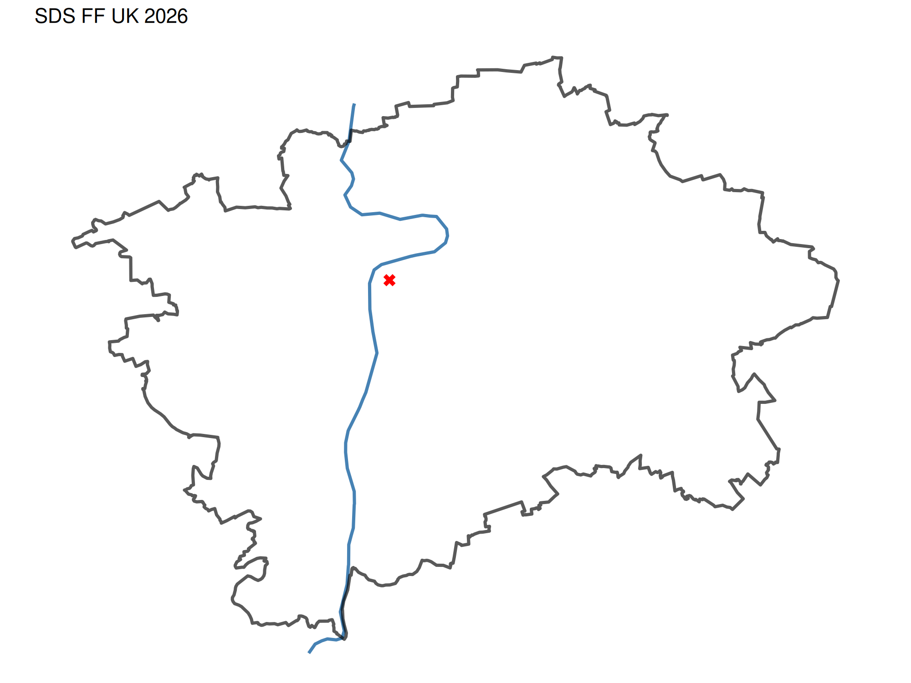

# 🌐 Spatial Data Science: od kreslení map k prostorové statistice

Workshop v rámci programu [Vybraná témata analýzy dat](https://sociology-fa-cu.github.io/vybranatemataanalyzy/) ve čtvrtek 29. října 2026

  

Struktura repozitáře:
- `JLA-SDS-filda.odp` prezentace ve formátu Open Office Impress
- `JLA-SDS-filda.pdf` prezentace ve formátu Adobe Acrobat Reader
- `/R/1-geocoding.R` získání dat a kreslení map / geocoding + [`{RCzechia}`](https://rczechia.jla-data.net/) package
- `/R/2-vánoční-kapr.R` získání dat a kreslení map / staťák + [`{czso}`](https://petrbouchal.xyz/czso/) package 
- `/R/3-dlouhověkost.R` testování statistické hypotézy nad daty historických cenzů
- `/R/4-benzín.R` testování statistické hypotézy nad geokódovanými cenovými daty
- `/R/5-hope+histogram.R` prostorová závislost a clustering
- `/R/6-využití-AI.R` ve službách datové vědy
- `/data` podkladová data pro výpočty